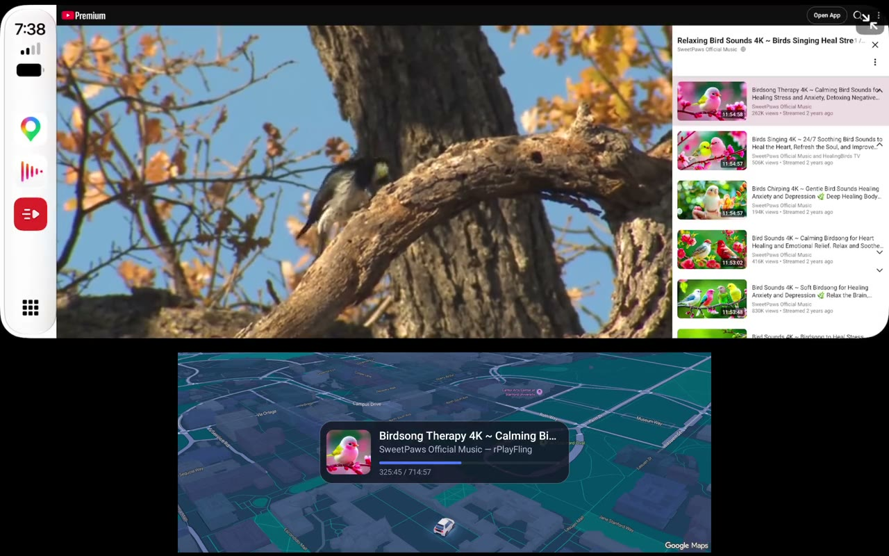
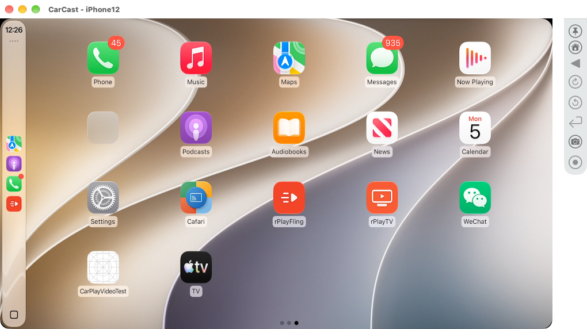
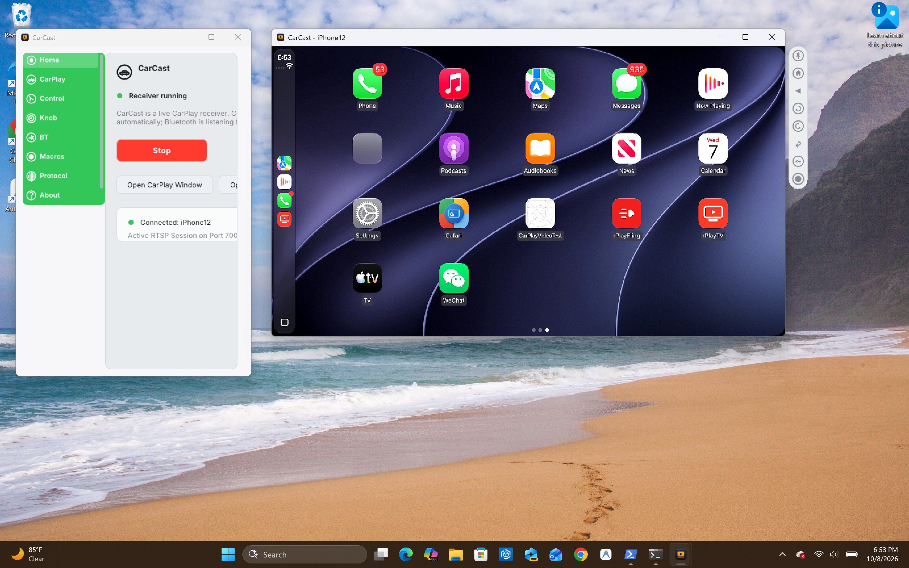

# CarCast

**iPhone and iPad (iCarCast):** [Join the TestFlight beta](https://testflight.apple.com/join/mgpX2urq) · [User guide](docs/icarcast-user-guide.md) ·
[Wi-Fi and network guide](docs/ios-network-guide.md) · [Android Auto on iPad](docs/icarcast-user-guide.md#android-auto) ·
[If a Wi-Fi network stopped working](docs/icarcast-user-guide.md#if-a-wi-fi-network-stopped-working)

**CAR# (CarPlay adapter on the iPhone, beta):** [User guide](docs/carsharp-user-guide.md)

CarCast turns a Windows PC, a Mac, an iPad, an iPhone, an Android tablet or an Android head unit into a CarPlay head unit. Connect an iPhone and CarPlay runs on the car's screen, on your desktop or on a tablet.

CarCast is built on an existing code base that has **shipped in millions of wireless CarPlay boxes and dongles**. On that foundation it is a **state-of-the-art CarPlay receiver** that already supports CarPlay's newest features: video playback in the car, multiple displays with an instrument cluster, the CarPlay Ultra cluster, and iAP2 Now Playing. Its roots are in **real head units**, so it's meant for real cars, not only developer desks.

- **Android head units and car owners:** a complete phone-connectivity system on the car's screen.
- **CarPlay box and head-unit makers:** OEM licenses (see [OEM licensing](#oem-licensing)).
- **Developers and test teams:** a CarPlay head unit on a desk, where you can see exactly what the phone sends, change how the "car" presents itself, and repeat a session as often as you need.

[Report a problem](https://github.com/rPlayAI/carcast-public/issues/new/choose) ·
[Release notes](docs/releases.md)

This repository is for **releases, documentation and issues**. The source code is not public.

## Contents

- [Platforms](#platforms) · [Demo](#demo)
- [Highlights](#highlights): [Video in the car](#carplay-video-playback-video-in-the-car) · [Multiple displays](#multiple-displays) · [CarPlay Ultra](#carplay-ultra) · [Now Playing](#iap2-media-track-info-now-playing)
- [macOS](#macos) ([guide](docs/macos.md)) · [Windows](#windows) ([guide](docs/windows.md))
- [Android](#android) ([guide](docs/android.md)) · [iOS and iPadOS](#ios-and-ipados) ([guide](docs/ios.md))
- [Who it's for](#who-its-for) · [OEM licensing](#oem-licensing) · [Status](#status) · [Reporting a problem](#reporting-a-problem) · [Feedback](#feedback)

## Platforms

| Platform | Status | What's included |
|---|---|---|
| **macOS** | Available | CarPlay receiver and Protocol Inspector |
| **Windows** | Available | CarPlay receiver and Protocol Inspector |
| **Android** (tablets and Android head units) | Available | CarPlay, plus AirPlay, DLNA and USB mirroring |
| **iOS and iPadOS** | TestFlight beta (or sideload) | iPad: CarPlay receiver, and Android Auto (experimental). iPhone: the same, plus CarPlay on the same iPhone and Connect to another CarCast screen |
| **Embedded Linux** (e.g. Allwinner V851S) | OEM firmware license | CarPlay receiver firmware for CarPlay boxes and adapters |

- **Desktop (macOS and Windows).** These versions focus on CarPlay and do not include AirPlay. AirPlay receiving and iPhone mirroring on the desktop come from our [rPlay](https://github.com/rPlayAI/rplay-linux) and [rPlayHub](https://github.com/rPlayAI/rPlayHub) projects.
- **Embedded Linux.** CarCast runs as firmware on low-cost SoCs such as the Allwinner V851S, the chips inside CarPlay boxes and wireless adapters. It's available to device makers under an OEM firmware license (see [OEM licensing](#oem-licensing)).
- **Android.** This version combines CarPlay with an AirPlay receiver, a DLNA renderer and USB screen mirroring, which makes it a complete phone-connectivity solution for **Android head units**:
  - CarPlay for iPhones.
  - Screen mirroring with Bluetooth control of the phone.
  - Video and music pushed from iPhones over AirPlay.
  - Casts from Android phones and video apps over DLNA.

## Demo

*[Watch the demo (1:24, with sound)](media/carcast-android-demo.mp4).*

The demo shows CarCast on a Pixel Tablet, connected to an iPhone 13 over wireless CarPlay.

1. Set up with the wizard.
2. Connect, and the CarPlay home screen appears with the car's own LEXUS icon.
3. Play videos from rPlayFling on the CarPlay screen.

The instrument cluster runs at the same time: a navigation map with the **Now Playing** card, which updates from iAP2 as tracks change.

> **Running iOS 27.2?** That release breaks direct rendering of video on the CarPlay screen. CarCast's video playback support works with it; see [CarPlay video playback](#carplay-video-playback-video-in-the-car).

## Highlights

### CarPlay video playback (video in the car)

CarCast supports CarPlay's newest feature: **video playback on the car screen** (iOS 27.2 and later). CarCast tells the iPhone it is a head unit that can play video. The phone then hands the video to the car, and CarCast plays it on the CarPlay screen with its own player.

> **Why this matters with iOS 27.2.** iOS 27.2 breaks **direct rendering**, where apps drew video onto the CarPlay screen themselves. On iOS 27.2 the only way to get video into the car is a head unit that supports CarPlay video playback. **CarCast does, and it works on iOS 27.2.** Below, an iPhone 12 on iOS 27.2 hands a video to CarCast on macOS. CarPlay shows Now Playing, then CarCast's own player takes over the car screen.

*iPhone 12, iOS 27.2: video played by CarCast on the CarPlay screen. [Watch the clip (12 s)](media/carcast-macos-video-playback-ios27_2.mp4) to see it go from Now Playing to CarCast's player to full screen. Sample video: Big Buck Bunny (© Blender Foundation, CC BY 3.0).*

- **Full session support:**
  - The video handoff, with play, pause and stop.
  - Buffered audio for the soundtrack.
  - Playback position and state reported back to the phone.
- **Like a car without internet.** The video can be fetched through the iPhone, as a real car does. Or CarCast fetches it directly when the computer is online.
- **Works at any screen size.** Video playback can be turned on for whichever display preset you choose.
- **Tested with apps that cast to CarPlay**, such as [rPlayFling](https://github.com/rPlayAI/rPlayFling-public).

### Multiple displays

A car often has more than one screen. CarCast gives the phone the **main CarPlay screen and an instrument cluster** at the same time, each with its own video stream.

- **One or two cluster displays** (the Android version supports two).
- **Cluster content:** a map, the navigation turn card, or an app view, with ETA on or off.
- **Configurable cluster size**, shown in its own window or panel.

### CarPlay Ultra

With an iPhone that supports **CarPlay Ultra**, the iPhone sends its gauge-cluster theme to the car, and the car draws the speedometer, tachometer and other gauges itself, around the phone's map.

- **CarCast draws the Ultra cluster** on Android with simulated car data (speed, rpm, fuel, range), next to the main CarPlay screen.
- **On by default** on Android: turn it off in Settings › Display › CarPlay Ultra.

### iAP2 media track info (Now Playing)

CarCast subscribes to the iPhone's **Now Playing updates over iAP2**, as a car with a cluster or a driver display does.

- **Track details:** title, artist, album, elapsed time and the app that's playing.
- **Shown on a Now Playing card** on Android, and every update can be inspected in the Protocol Inspector on macOS.

## macOS

*CarPlay from an iPhone 12 on **iOS 27.2** in a CarCast window on macOS. rPlayFling and rPlayTV are third-party CarPlay apps shown alongside the built-in ones; the side bar has the Home, Back and knob controls, plus screenshot and recording buttons.*

**[macOS guide](docs/macos.md)**: everything about CarCast on macOS, with screenshots.

## Windows

*CarPlay from an iPhone 12 on **iOS 27.2**, running live on Windows 11 with CarCast. The dedicated CarPlay screen features a top-aligned companion toolbar with Home, Back, knob rotary controls, and screenshot/recording actions.*

**[Windows guide](docs/windows.md)**: everything about CarCast on Windows, with screenshots.

## Android

**Download:** [CarCast for Android 0.3.25](https://github.com/rPlayAI/carcast-public/releases/tag/android-0.3.25) (APK; test build, stops working after 90 days, on 2027-01-19).

*CarPlay on a Pixel Tablet, with the CarPlay Ultra instrument cluster (speedometer and tachometer) drawn by CarCast below the main screen, and the Now Playing card.*

**[Android guide](docs/android.md)**: everything about CarCast on Android, with screenshots.

## iOS and iPadOS

CarCast runs on an iPad or an iPhone as a wireless CarPlay screen (**iCarCast** on TestFlight). See the **[iCarCast user guide](docs/icarcast-user-guide.md)**.

**[iPhone and iPad guide](docs/ios.md)**: everything about CarCast on iOS and iPadOS, with screenshots.

## Who it's for

- **CarPlay box makers.** License CarCast as the CarPlay receiver inside your box or adapter.
- **Android head-unit makers and installers.** Add CarPlay, AirPlay, DLNA and mirroring to an Android head unit in one app.
- **Drivers with an iPad.** Mount it as a CarPlay screen in a car that has none.
- **Drivers with an Android head unit.** Get CarPlay, including video while parked, an instrument cluster and Now Playing.
- **CarPlay app developers.** Test audio, navigation, communication and video apps on a real iPhone without a car.
- **QA teams.** Reproduce car-only bugs on a desk and capture logs to attach to a ticket.
- **Head-unit and accessory teams.** Compare behaviour against a reference receiver.

## OEM licensing

We provide **OEM licenses** to makers of **CarPlay boxes** (adapters and multimedia boxes that plug into the car) and **Android head units**.

- **Embedded Linux firmware:** for boxes and adapters built on SoCs such as the Allwinner V851S.
- **Android app or system integration:** for Android head units and Android-based boxes.

A license includes:

- **The CarCast receiver for your product:** CarPlay with video playback, multiple displays, the instrument cluster and Now Playing.
- **Optionally, the rest of the Android stack:** AirPlay, DLNA and USB mirroring.
- **Branding and vehicle configuration:** car name, OEM icon, display and cluster layouts.
- **Engineering support for bring-up.** The Protocol Inspector is included, to find connection problems on your hardware.

For OEM licensing, [open an issue](https://github.com/rPlayAI/carcast-public/issues/new?title=OEM%20licensing) titled *OEM licensing*, and we'll get in touch.

## Status

CarCast is in active development on Windows, macOS, iOS/iPadOS and Android. Downloads are posted under [Releases](https://github.com/rPlayAI/carcast-public/releases).

## Reporting a problem

Please [open an issue](https://github.com/rPlayAI/carcast-public/issues/new/choose) with your platform (Windows, macOS, iOS/iPadOS or Android),
the CarCast version, your iPhone model and iOS version, and a screenshot if you can. On Android, *Settings › Share logs*
saves the log from a failed connect.

## Feedback

Ideas and feature requests are welcome too — use the *Feature request* form under
[Issues](https://github.com/rPlayAI/carcast-public/issues/new/choose).
